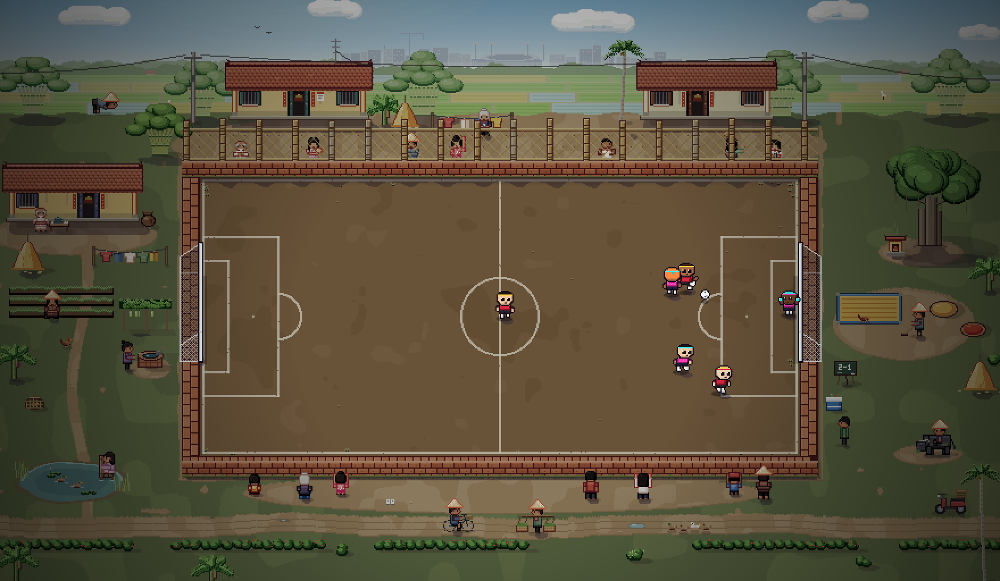
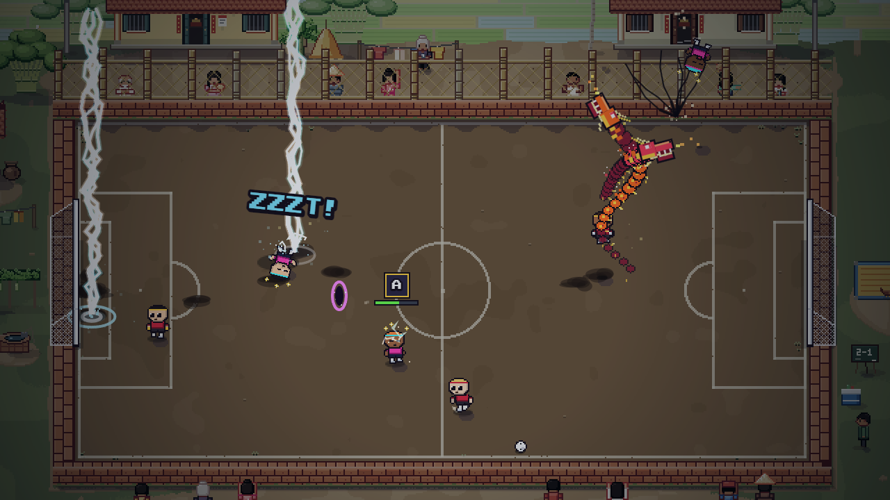

# Village

The reference arena: the outskirts rung of the climb, by day. It follows every rule in these docs and runs in the game (arena `village`).

The full 880×512 area at 2×, with a live match. The game screen is the 640×360 window at (120, 76).

The game screen during a match: Rising Dragon and Thunderstorm on the dark stage.

## What's in it

- **Pitch:** packed dirt in the floor band, lime lines (cream, slightly uneven), a few worn patches, grass tufts only along the edges.
- **Edges:** a laterite wall. The top is a bamboo lattice on a laterite base, see-through, with neighbours watching through it. The side rims show their top; the bottom wall also shows its outside face.
- **Behind the top wall:** neighbours, two village houses, bamboo, rice paddies, then the city skyline with the stadium in the middle.
- **Margins:** each corner holds one scene. Grandpa at his tea table by a house, a weeder in the vegetable beds, a well, a woman washing at the pond, a shrine under a banyan, a raker by rice drying on a tarp, a buffalo with a kid, the scoreboard and cooler, a lane with a cyclist and a pole vendor, a hedge along the bottom.
- **Light touches:** conical hats, plastic stools, laterite, a straw stack.

## How it's built

The scene is code: `src/render/art/`, loaded by the game page only.

| File | What |
|---|---|
| `kit.js` | `SFC.Art.Kit`: pixel drawing, colour ramps (own-colour outline, cool darks, warm lights), shadow caster, stage grade, vignette |
| `npcs.js` | `SFC.Art.Npc`: villagers (4 facings, poses, held items) and animals |
| `props.js` | `SFC.Art.Prop`: walls, houses, trees, village objects |
| `village.js` | `SFC.Art.Village`: the 880×512 scene, its layers, goal shadows, the in-game stage and player shadows |

- **Layers:** background (sky, skyline, paddies, ground, pond, pitch, lines), then props and NPCs as one list sorted by their feet, so a villager behind the lattice is covered by it. Each layer can be drawn on its own.
- **Reusable pieces:** every prop and NPC is a function `(ctx, x, y, opts)` where (x, y) is its feet on the ground; `opts.t` picks the animation frame.
- **In the game:** `config/arenas.config.js` gives the village arena `scene: 'Village'`. `Renderer` draws `Village.frame()`, the full 880×512 scene drawn once (about 0.8 s, first use only), so wider or taller screens see more of it. `Village.stage()` cuts the 640×360 view for menu thumbnails. The scene stands still for now. `Renderer` calls `Village.shadows` every frame for the players' shadows, and the old crowd sprites are skipped (the crowd sound stays).

## Renders

Needs the game server (`npm run serve`):

- `node tools/art-direction/render.mjs`: the full frame, each layer, a catalogue of people / props / plants, and zoomed crops.
- `node tools/art-direction/action.mjs [count] [seed]`: busy moments from an AI match where every player has an Ultimate, as the full frame and as the game screen.
- `node tools/art-direction/aspect.mjs [seed]`: one match moment (with an Ultimate cut-in) at 16:9, 16:10, 3:2, 4:3, 5:4, 21:9 and 32:9.

Output goes to `tools/art-direction/out/village/`.
